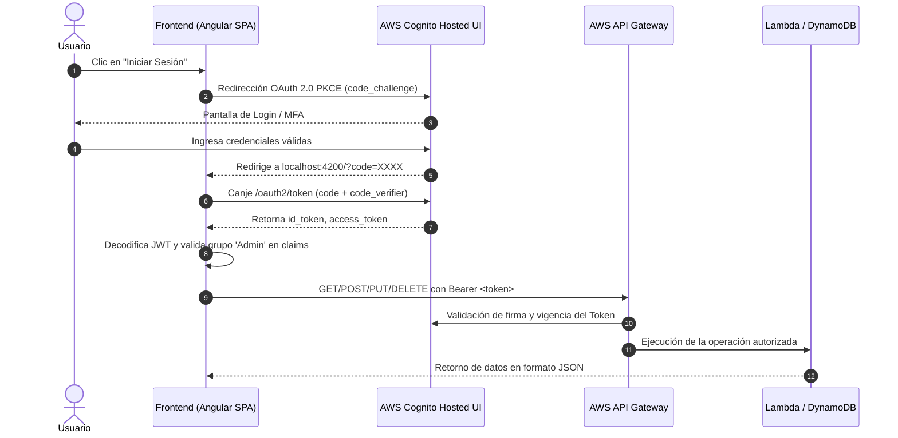

# Auditoría Técnica y Especificación de Arquitectura — Frontend Pedidos 360

Este documento proporciona una radiografía técnica exhaustiva del proyecto **`pedidos360-front`** para facilitar su análisis, auditoría cruzada con el backend y comprensión por parte de sistemas de Inteligencia Artificial o desarrolladores.

---

## 1. Identificación y Propósito del Sistema

* **Nombre del Proyecto:** `pedidos360-front`
* **Tipo de Aplicación:** Single Page Application (SPA) para Backoffice Corporativo.
* **Dominio del Negocio:** Gestión y despacho de pedidos de infraestructura tecnológica, servidores y hardware cloud (*enterprise tier*).
* **Rol Arquitectónico:** Cliente web desacoplado y sin estado que consume servicios *Cloud Native* expuestos en **AWS API Gateway** y delega la gestión de identidad en **AWS Cognito**.

---

## 2. Versiones de Software y Stack Tecnológico

| Componente / Librería | Versión | Rol / Justificación Técnica |
| :--- | :--- | :--- |
| **Angular Framework** | `^22.1.0` | Arquitectura moderna basada en **Standalone Components**, sin `NgModule` y con el nuevo motor de control de flujo (`@if`, `@for`). |
| **TypeScript** | `~6.0.2` | Tipado estático estricto y compilación moderna ES2022+. |
| **angular-oauth2-oidc**| `^22.0.2` | Manejo del flujo OIDC/OAuth 2.0 con PKCE contra AWS Cognito Hosted UI. |
| **aws-amplify** | `^6.20.0` | SDK de AWS disponible para utilidades Cloud. |
| **RxJS** | `~7.8.0` | Manejo de programación reactiva (`BehaviorSubject`, `Observable`, `HttpClient`). |
| **Bootstrap** | `5.3.3` (CDN) | Sistema de rejilla y utilidades responsivas base. |
| **Custom Styling** | CSS3 puro | Diseño propietario *Dark Mode Cyberpunk* con *Glassmorphism*, gradientes radiales y microanimaciones 3D. |
| **Angular Build / CLI** | `^22.1.7` | Pipeline de empaquetado rápido basado en Vite / Esbuild. |
| **Vitest / JSDom** | `^4.0.8` | Framework de pruebas unitarias ultrarrápido. |
| **Node / Package Mgr** | `npm@11.16.0` | Gestor de paquetes configurado en el proyecto. |

---

## 3. Estructura de Carpetas y Distribución de Código

```
pedidos360-front/
├── .vscode/                     # Configuración de depuración y extensiones de VSCode
├── public/                      # Recursos estáticos servidos sin procesar
│   └── favicon.ico
├── src/
│   ├── app/
│   │   ├── services/
│   │   │   ├── auth.service.ts      # [Seguridad] Lógica OAuth2 PKCE, claims JWT, grupos Admin
│   │   │   └── pedidos.service.ts   # [Datos/API] Cliente HTTP REST hacia API Gateway
│   │   ├── app.config.ts            # Proveedores globales (Router, HTTP, OAuth Client)
│   │   ├── app.routes.ts            # Tabla de enrutamiento (SPA centralizada en raíz)
│   │   ├── app.ts                   # Controlador principal (Estado reactivo, modales, CRUD)
│   │   ├── app.html                 # Vista: Glassmorphism Navbar, Lock Screen y CRUD Table
│   │   ├── app.css                  # Hoja de estilos con variables de color, neón y glass
│   │   └── app.spec.ts              # Suite de pruebas unitarias del componente principal
│   ├── environments/
│   │   └── environment.ts           # Parámetros de configuración AWS (Cognito y API Gateway)
│   ├── index.html                   # HTML base con fuentes de Google y CDN de Bootstrap
│   ├── main.ts                      # Bootstrap de la aplicación Angular standalone
│   └── styles.css                   # Reseteo global y tema oscuro base
├── angular.json                     # Configuración del CLI de Angular
├── package.json                     # Manifiesto de dependencias y scripts de ejecución
├── tsconfig.json                    # Configuración raíz de TypeScript
└── tsconfig.app.json                # Configuración específica de TypeScript para el frontend
```

---

## 4. Contratos de Datos y Tipos (Frontend ↔ Backend)

### 4.1. Interfaz de Datos (`Pedido`)
Definida en `src/app/services/pedidos.service.ts`:

```typescript
export interface Pedido {
  id?: string | number;       // Identificador único generado por BD (ej: DynamoDB / UUID)
  producto: string;           // Nombre o modelo del producto (Requerido)
  descripcion?: string;       // Detalle técnico (opcional en creación, renderizado dinámico en UI)
  cantidad: number;           // Cantidad solicitada (mínimo 1)
  stock?: number;             // Stock disponible al momento de la orden
  estado?: string;            // 'En preparación' | 'Enviado' | 'Entregado'
  imageUrl?: string;          // URL pública (ej: bucket S3 o CDN) de la miniatura
}
```

### 4.2. Endpoints y Verbos HTTP (API Gateway)
Configurados en `environment.api.pedidosUrl`:
* **URL Base:** `https://2c0yqndsn0.execute-api.us-east-1.amazonaws.com/test/api/pedidos`
* **Cabecera requerida en todas las llamadas:**
  ```http
  Authorization: Bearer <ID_TOKEN o ACCESS_TOKEN>
  Content-Type: application/json
  ```

| Verbo | Endpoint | Payload Enviado | Respuesta Esperada | Descripción |
| :--- | :--- | :--- | :--- | :--- |
| **GET** | `/api/pedidos` | *Ninguno* | `Pedido[]` o `{ Items: Pedido[] }` o `{ pedidos: Pedido[] }` | Lista todas las órdenes. El frontend soporta respuestas directas en array o estructuradas desde DynamoDB. |
| **POST** | `/api/pedidos` | `{ producto, cantidad, stock, imageUrl, estado }` | `{ id: "..." }` o `Pedido` | Registra una nueva orden en base de datos. |
| **PUT** | `/api/pedidos/{id}` | Objeto `Pedido` completo con nuevo `estado` | `{ message: "..." }` o `Pedido` | Actualiza el estado de la orden seleccionada. |
| **DELETE**| `/api/pedidos/{id}` | *Ninguno* | `{ message: "..." }` o status `200/204` | Elimina o cancela la orden por su identificador. |

---

## 5. Arquitectura de Autenticación y Autorización (AWS Cognito)



### 5.1. Configuración OIDC de Cognito
* **User Pool Issuer:** `https://cognito-idp.us-east-1.amazonaws.com/us-east-1_C1DQHPBOn`
* **App Client ID:** `5f24qerscjusiu3apprn79gbdc` (Cliente Público, sin secret, habilitado para PKCE).
* **Hosted UI Domain:** `https://us-east-1c1dqhpbon.auth.us-east-1.amazoncognito.com`
* **Scopes Configurados:** `openid email profile rs-api-pedidos/pedidos-read`

### 5.2. Control de Acceso por Roles (RBAC en Frontend)
* El método `isAdmin()` inspecciona el claim `cognito:groups` del token JWT.
* **Si el usuario pertenece al grupo `"Admin"`**:
  * Acceso completo para crear nuevos pedidos (POST).
  * Habilitado para editar estados (PUT).
  * Habilitado para cancelar pedidos (DELETE).
* **Si el usuario NO pertenece al grupo `"Admin"`**:
  * Se mantiene en modo de solo lectura (los botones de acción muestran un candado 🔒 y quedan deshabilitados con directivas `[disabled]="!esAdmin"`).

---

## 6. Puntos Fuertes ("Pros") del Frontend

1. **Seguridad Robusta en Clientes Públicos (PKCE):**
   * Implementa el estándar OAuth 2.0 Authorization Code Flow con PKCE (*Proof Key for Code Exchange*), protegiendo la aplicación contra intercepciones de código de autorización en el navegador sin exponer claves secretas.
2. **Defensa en Profundidad y Bloqueo Preventivo:**
   * Las llamadas HTTP no autenticadas se interceptan de manera preventiva en `PedidosService` retornando observables vacíos (`of([])`), evitando llamadas espurias y saturación por errores 401 en el API Gateway.
3. **Resiliencia y Modo Offline / Demo:**
   * Si el API Gateway se encuentra temporalmente inalcanzable o en mantenimiento, la interfaz degrada elegantemente a un catálogo mock corporativo, permitiendo validar la experiencia de usuario y el diseño sin romper el flujo de la aplicación.
4. **Diseño Visual de Alta Fidelidad (Glassmorphism & UX Tech):**
   * Gráficos isométricos SVG nativos con gradientes y filtros de resplandor neón.
   * Pantalla de bloqueo moderna (`auth-lock-overlay`) que preserva la privacidad del panel cuando la sesión no está activa.
   * Notificaciones dinámicas de feedback (*alert toasts*) con auto-cierre.
5. **Arquitectura Angular de Última Generación:**
   * Componentes `standalone` con sintaxis declarativa limpia y reactividad integrada (`BehaviorSubject` + `subscribe`).

---

## 7. Checklist de Auditoría para el Desarrollador o IA del Backend

- [ ] **Configuración de CORS en API Gateway:**
  - El backend debe permitir el origen `http://localhost:4200` (o `*` para entornos de prueba).
  - Encabezados permitidos (`Allow-Headers`): `Authorization`, `Content-Type`, `X-Amz-Date`, `X-Api-Key`, `X-Amz-Security-Token`.
  - Métodos permitidos (`Allow-Methods`): `OPTIONS, GET, POST, PUT, DELETE`.
  - La respuesta al preflight `OPTIONS` debe retornar código `200` con los encabezados CORS correspondientes.
- [ ] **Tipo de Validador en API Gateway (Authorizer):**
  - **Si usa Cognito User Pool Authorizer nativo:** Espera el **ID Token** en el encabezado `Authorization: Bearer <ID_TOKEN>`.
  - **Si usa OAuth Scopes con Resource Server:** Espera el **Access Token** que contenga el scope `rs-api-pedidos/pedidos-read`.
  - *Nota:* `PedidosService` envía prioritariamente el ID Token y luego el Access Token como fallback.
- [ ] **Estructura del Payload GET:**
  - El frontend soporta tanto un array directo (`[ { id, producto, ... } ]`) como el envoltorio típico de DynamoDB / Lambda (`{ Items: [ ... ] }` o `{ pedidos: [ ... ] }`).
- [ ] **Generación de IDs en POST:**
  - Al recibir una solicitud `POST /api/pedidos`, el backend debe generar el identificador (UUID o string tipo `ORD-XXXX`) y devolverlo en la respuesta JSON `{ id: "..." }` para que la UI lo sincronice.
- [ ] **Validación de Roles en Backend (Crucial):**
  - Si bien el frontend bloquea la interfaz para usuarios no administradores, las funciones Lambda o los microservicios deben revalidar en el JWT el grupo `cognito:groups` antes de ejecutar `POST`, `PUT` o `DELETE` para garantizar seguridad de extremo a extremo.
