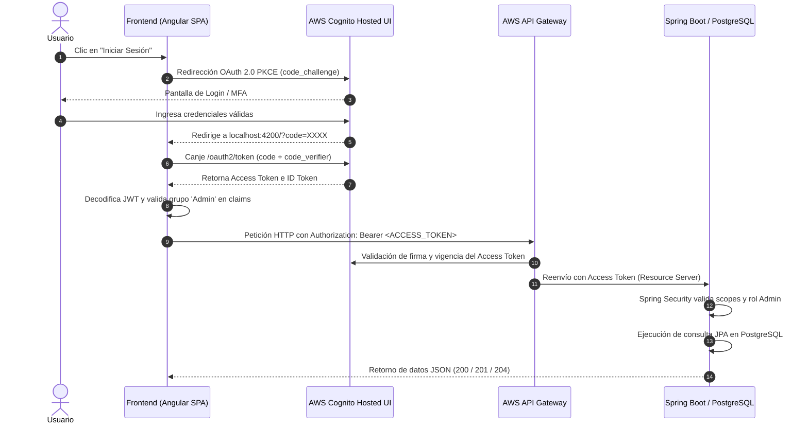

# Auditoría Técnica y Especificación de Arquitectura — Frontend Pedidos 360

Este documento proporciona una radiografía técnica exhaustiva del proyecto **`pedidos360-front`** adaptado a su **arquitectura definitiva** (Angular + AWS Cognito + AWS API Gateway + Backend Java 17 / Spring Boot + PostgreSQL) para facilitar su análisis, auditoría cruzada con el backend y comprensión por parte de sistemas de Inteligencia Artificial o desarrolladores.

---

## 1. Identificación y Propósito del Sistema

* **Nombre del Proyecto:** `pedidos360-front`
* **Tipo de Aplicación:** Single Page Application (SPA) para Backoffice Corporativo.
* **Dominio del Negocio:** Gestión y despacho de pedidos de infraestructura tecnológica, servidores y hardware cloud (*enterprise tier*).
* **Rol Arquitectónico:** Cliente web desacoplado y sin estado que consume servicios expuestos a través de **AWS API Gateway** hacia un backend en **Java 17 con Spring Boot y base de datos relacional PostgreSQL**, delegando la gestión de identidad en **AWS Cognito**.

---

## 2. Versiones de Software y Stack Tecnológico

| Componente / Librería | Versión | Rol / Justificación Técnica |
| :--- | :--- | :--- |
| **Angular Framework** | `^22.1.0` | Arquitectura moderna basada en **Standalone Components**, sin `NgModule` y con el nuevo motor de control de flujo (`@if`, `@for`). |
| **TypeScript** | `~6.0.2` | Tipado estático estricto y compilación moderna ES2022+. |
| **angular-oauth2-oidc**| `^22.0.2` | Manejo del flujo OIDC/OAuth 2.0 con PKCE contra AWS Cognito Hosted UI. |
| **aws-amplify** | `^6.20.0` | SDK de AWS disponible para utilidades Cloud. |
| **RxJS** | `~7.8.0` | Manejo de programación reactiva (`BehaviorSubject`, `Observable`, `HttpClient`, operadores `map`). |
| **Bootstrap** | `5.3.3` (CDN) | Sistema de rejilla y utilidades responsivas base. |
| **Custom Styling** | CSS3 puro | Diseño propietario *Dark Mode Cyberpunk* con *Glassmorphism*, gradientes radiales y microanimaciones 3D. |
| **Angular Build / CLI** | `^22.1.7` | Pipeline de empaquetado rápido basado en Vite / Esbuild. |
| **Vitest / JSDom** | `^4.0.8` | Framework de pruebas unitarias ultrarrápido. |
| **Node / Package Mgr** | `npm@11.16.0` | Gestor de paquetes configurado en el proyecto. |

---

## 3. Estructura de Carpetas y Distribución de Código

```
pedidos360-front/
├── .vscode/                     # Configuración de depuración y extensiones de VSCode
├── public/                      # Recursos estáticos servidos sin procesar
│   └── favicon.ico
├── src/
│   ├── app/
│   │   ├── services/
│   │   │   ├── auth.service.ts      # [Seguridad] Lógica OAuth2 PKCE, Access Token, claims JWT, grupos Admin
│   │   │   └── pedidos.service.ts   # [Datos/API] Cliente HTTP REST hacia API Gateway / Spring Boot
│   │   ├── app.config.ts            # Proveedores globales (Router, HTTP, OAuth Client)
│   │   ├── app.routes.ts            # Tabla de enrutamiento (SPA centralizada en raíz)
│   │   ├── app.ts                   # Controlador principal (Estado reactivo, modales, CRUD, gestión de errores HTTP)
│   │   ├── app.html                 # Vista: Glassmorphism Navbar, Lock Screen y CRUD Table
│   │   ├── app.css                  # Hoja de estilos con variables de color, neón y glassmorphism
│   │   └── app.spec.ts              # Pruebas unitarias con mocks de servicios y validaciones de estado
│   ├── environments/
│   │   ├── environment.ts           # Parámetros de configuración AWS (Cognito y API Gateway hacia Spring Boot)
│   │   └── environment.development.ts # Parámetros de entorno de desarrollo local y AWS
│   ├── index.html                   # HTML base con fuentes de Google y CDN de Bootstrap
│   ├── main.ts                      # Bootstrap de la aplicación Angular standalone
│   └── styles.css                   # Reseteo global y tema oscuro base
├── angular.json                     # Configuración del CLI de Angular y optimización de compilación
├── package.json                     # Manifiesto de dependencias y scripts de ejecución
├── tsconfig.json                    # Configuración raíz de TypeScript
└── tsconfig.app.json                # Configuración específica de TypeScript para el frontend
```

---

## 4. Contratos de Datos y Tipos (Frontend ↔ Backend Spring Boot / PostgreSQL)

### 4.1. Interfaz de Datos (`Pedido`)
Definida en `src/app/services/pedidos.service.ts`:

```typescript
export interface Pedido {
  id?: string | number;       // Clave primaria generada por PostgreSQL (Long autoincremental o UUID)
  producto: string;           // Nombre o modelo del producto (Requerido)
  descripcion?: string;       // Detalle técnico (opcional)
  cantidad: number;           // Cantidad solicitada (mínimo 1)
  stock?: number;             // Stock disponible en inventario
  estado?: string;            // 'En preparación' | 'Enviado' | 'Entregado'
  imageUrl?: string;          // URL pública (CDN, HTTPS o S3) de la miniatura
}
```

### 4.2. Endpoints y Verbos HTTP (API Gateway ↔ Spring Boot)
Configurados en `environment.api.pedidosUrl`:
* **URL Base en API Gateway:** `https://2c0yqndsn0.execute-api.us-east-1.amazonaws.com/test/api/pedidos`
* **URL Local de Desarrollo:** `http://localhost:8080/api/pedidos`
* **Cabecera requerida en todas las llamadas:**
  ```http
  Authorization: Bearer <ACCESS_TOKEN>
  Content-Type: application/json
  ```

| Verbo | Endpoint | Payload Enviado | Respuesta Esperada | Descripción |
| :--- | :--- | :--- | :--- | :--- |
| **GET** | `/api/pedidos` | *Ninguno* | `Pedido[]` o `Page<Pedido>` (`{ content: Pedido[] }`) | Lista todas las órdenes almacenadas en PostgreSQL. El frontend mapea automáticamente listas directas o respuestas paginadas de Spring Data. |
| **POST** | `/api/pedidos` | `{ producto, descripcion, cantidad, stock, imageUrl, estado }` (sin `id`) | `Pedido` (`201 Created` con `id` asignado por PostgreSQL) | Registra una nueva orden en la base de datos PostgreSQL. |
| **PUT** | `/api/pedidos/{id}` | Objeto `Pedido` completo con nuevo `estado` | `Pedido` (`200 OK`) | Actualiza el estado o detalle de la orden seleccionada. |
| **DELETE**| `/api/pedidos/{id}` | *Ninguno* | `204 No Content` o `200 OK` | Elimina la orden por su identificador en PostgreSQL. |

---

## 5. Arquitectura de Autenticación y Autorización (AWS Cognito)



### 5.1. Uso del Access Token vs ID Token
* **Access Token:** Es el token transmitido en la cabecera `Authorization: Bearer <token>` hacia el backend Spring Boot. Contiene el claim `token_use: "access"`, el scope `rs-api-pedidos/pedidos-read` y los grupos del usuario. Es el estándar requerido por `spring-boot-starter-oauth2-resource-server`.
* **ID Token:** Se conserva para la visualización de la identidad del usuario (`email`, `username`, `sub`) en la barra superior.

### 5.2. Control de Acceso por Roles (RBAC)
* El método `isAdmin()` en `AuthService` valida la presencia del grupo de administradores en el claim `cognito:groups` (admitiendo `'Admin'`, `'admin'`, `'ADMIN'` y `'ROLE_ADMIN'`).
* **Usuarios con rol Admin:** Habilitados para crear pedidos (POST), editar estados (PUT) y cancelar órdenes (DELETE).
* **Usuarios sin rol Admin:** Acceso en modo solo lectura; las acciones destructivas o de modificación muestran un candado 🔒 y directiva `[disabled]="!esAdmin"`. Adicionalmente, el backend Spring Boot revalida este permiso con `@PreAuthorize("hasRole('Admin')")` o anotaciones equivalentes de Spring Security.

---

## 6. Manejo Transparente de Errores y Ausencia de Datos Falsos

Para garantizar que los datos de prueba nunca enmascaren fallos reales del backend:
1. **Detección y Notificación de Errores HTTP:**
   * **Error de conexión / CORS (Status 0):** Alerta explicativa detallando que el backend Spring Boot o API Gateway se encuentra inalcanzable.
   * **No Autorizado (Status 401):** Alerta solicitando renovación de sesión en AWS Cognito.
   * **Acceso Denegado (Status 403):** Alerta informando que la cuenta no pertenece al grupo `Admin`.
   * **Error de Servidor (Status 500+):** Alerta informando fallo interno en Spring Boot.
2. **Limpieza de Estado en Falla:**
   * Si `cargarPedidos()` recibe un error del servidor, limpia la lista (`pedidos = []`), impidiendo que órdenes simuladas generen una falsa sensación de sincronización exitosa.
3. **Persistencia Sincrónica:**
   * Las operaciones de creación (POST), edición (PUT) y eliminación (DELETE) solo actualizan la vista cuando la llamada HTTP al backend retorna exitosamente (`next`). Si el servidor rechaza la solicitud, el modal permanece abierto, se muestra el error específico y no se insertan registros fantasma.

---

## 7. Checklist de Auditoría para el Desarrollador del Backend Spring Boot

- [ ] **Configuración de CORS en Spring Boot / API Gateway:**
  - Permitir el origen `http://localhost:4200`.
  - Encabezados permitidos: `Authorization`, `Content-Type`.
  - Métodos permitidos: `GET, POST, PUT, DELETE, OPTIONS`.
- [ ] **Spring Security OAuth2 Resource Server:**
  - Configurar `spring.security.oauth2.resourceserver.jwt.issuer-uri=https://cognito-idp.us-east-1.amazonaws.com/us-east-1_C1DQHPBOn`.
  - Mapear `cognito:groups` a `GrantedAuthority` (ej: `ROLE_Admin` o `Admin`).
- [ ] **Estructura de la Entidad JPA `Pedido`:**
  - Tabla: `pedidos` en base de datos PostgreSQL.
  - Campos: `id` (Long o UUID), `producto` (String), `descripcion` (String), `cantidad` (Integer), `stock` (Integer), `estado` (String), `imageUrl` o `image_url` (String).
- [ ] **Respuestas REST:**
  - `GET /api/pedidos` -> `List<Pedido>` o `Page<Pedido>`.
  - `POST /api/pedidos` -> Retornar el `Pedido` persistido con su ID asignado y código `201 Created`.
  - `PUT /api/pedidos/{id}` -> Retornar `200 OK`.
  - `DELETE /api/pedidos/{id}` -> Retornar `204 No Content` o `200 OK`.
